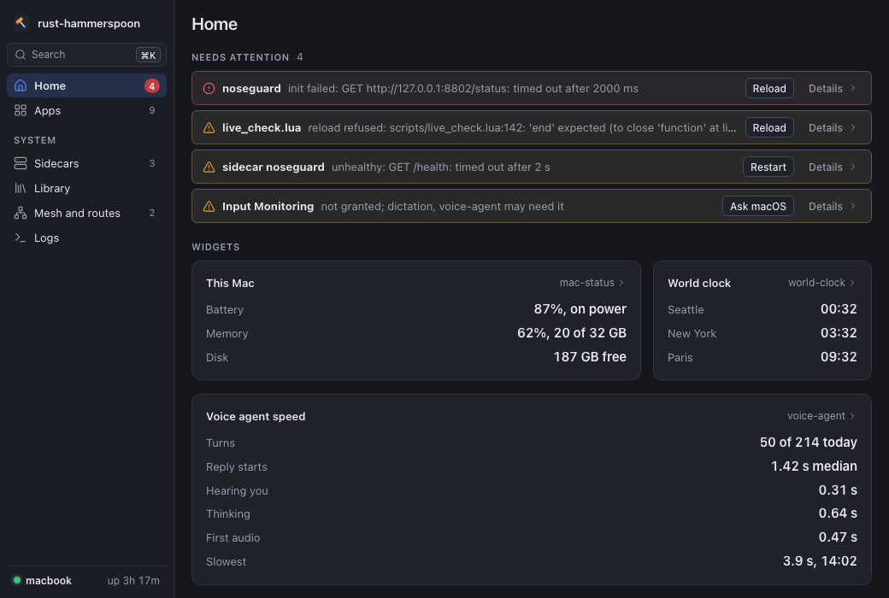

<div align="center">

# bricolo

**Every device you own, working as one computer.**

A personal automation node in Rust. Write a hotkey, a voice command or a widget once,<br>
and let it run on whichever of your machines does the job best.

[](https://github.com/Pierre-Mike/bricolo/actions/workflows/ci.yml)
[](LICENSE)

-1b2761.svg)

[Website](https://pierre-mike.github.io/bricolo/) ·
[Getting started](docs/getting-started.md) ·
[The big idea](docs/vision.md) ·
[Build an app](docs/apps.md) ·
[Design](docs/design.md)



</div>

## The big idea

Your laptop has the keyboard. Your desktop has the GPU. A home server has the disks, and the Mac in the kitchen has the speakers. Today each one runs its own little island of scripts, and none of them can borrow what the others are good at.

bricolo turns those islands into one system. Every device runs the same small node, and every node offers the same **standard library**: hotkeys, clipboard, windows, microphone, speech to text, text to speech, files, shell, HTTP and more. Your automations call that library and never ask where the work happens. One line in a rules file decides.

```toml
# rules.toml on the laptop
[routes]
speech = ["desktop", "local"]   # transcribe on the desktop's GPU, fall back to this machine
tts    = ["kitchen-mac"]        # speak through the kitchen speakers
```

```lua
-- scripts/dictate.lua: press a chord to record, press it again to type what you said
local rec
bricolo.hotkey.bind({ "ctrl", "alt", "cmd" }, "d", function()
  if not rec then
    rec = assert(bricolo.mic.record_start())
  else
    local path = assert(bricolo.mic.record_stop(rec))
    rec = nil
    local text = assert(bricolo.speech.transcribe_file(path))  -- runs on the desktop GPU
    bricolo.keyboard.type_text(text)                           -- types on this laptop
  end
end)
```

The script is the same whether the desktop is awake or asleep. The router picks the device, encrypts the call over a direct peer-to-peer link, and falls back when a machine is gone.

It started as a port of a [Hammerspoon](https://www.hammerspoon.org/) setup that had outgrown one Mac. Read the [full vision](docs/vision.md) for where it goes next.

## What you get

| | |
|---|---|
| **One standard library** | 24 capabilities defined once in [WIT](wit/): `hotkey`, `clipboard`, `window`, `app`, `screen`, `selection`, `keyboard`, `mouse`, `mic`, `camera`, `audio`, `speech`, `tts`, `notify`, `disk`, `files`, `kv`, `secrets`, `shell`, `http`, `system`, `timer`, `log` and `ui`. |
| **Lua scripts** | Drop a `.lua` file in `scripts/` and it runs. Save it and it reloads. Good for personal glue. |
| **Sandboxed plugins** | Rust compiled to WebAssembly components. One `.wasm` runs on every OS, and a plugin can call only what you approved at install. |
| **Sidecars** | Bring any model or library as a local HTTP server in Python, Node.js or Rust. The node starts it, health-checks it, restarts it and can share it with your other devices. |
| **The mesh** | Pair devices by key. Calls travel over encrypted [iroh](https://iroh.computer) QUIC or Tailscale, with per-peer allow lists and ordered fallback. |
| **The hub** | A Tauri app with cards for every app, widgets, sidecars, peers and live logs, plus floating panels (captions, toasts, choice lists) that scripts can show. |
| **Built for coding agents** | `bricolo skill install` teaches Claude Code, Codex, Gemini CLI, OpenCode or Cursor to build, install and check a whole app from one sentence. |
| **Installs like an app** | A signed macOS app, `bricolo service` for login startup (LaunchAgent, systemd, Task Scheduler), Linux tarballs, and installs from GitHub releases pinned by hash. |

## How it works

```
        Laptop node                                    Desktop node (GPU)
┌──────────────────────────────────┐           ┌──────────────────────────────────┐
│  Lua scripts      WASM plugins   │           │  WASM plugins                    │
│        \              /          │           │        |                         │
│      standard library (WIT)      │           │  standard library (WIT)          │
│                |                 │           │        |                         │
│      router ── rules.toml        │   iroh    │  router ── peers.toml            │
│       /               \          │   QUIC    │        |                         │
│  local providers    remote ──────┼───────────┼─► local providers                │
│  hotkey, mic, keyboard           │           │     speech (Whisper, Parakeet)   │
│  sidecars on localhost           │           │     sidecars on localhost        │
└──────────────────────────────────┘           └──────────────────────────────────┘
                 bricolo-ui hub: cards, switches, widgets, panels, logs
```

1. **Apps call the standard library.** Scripts reach it through the `bricolo` global; plugins import WIT interfaces.
2. **The router reads your rules.** Each routable call goes to a local provider or to a trusted peer, with fallback.
3. **Providers do the real work.** Native code per OS (Accessibility and CGEvent on macOS, X11, Hyprland and D-Bus on Linux, Win32 and WinRT on Windows), or a sidecar you run.

## Quick start

### Run it from a checkout

```bash
cargo install --path crates/node                 # installs `bricolo`, templates included
bricolo run &                                         # start the node
bricolo new-script clip --template hotkey-tool        # ctrl+alt+cmd+c shows the clipboard
bricolo status                                        # "clip" is running
```

`bricolo new-script` writes `~/.config/bricolo/scripts/clip.lua`. The node picks it up as soon as the file appears and reloads it each time you save.

### Install it on a Mac, with the hub

```bash
scripts/macos-dev-identity.sh      # once: a local signing identity, so permissions survive rebuilds
just install-macos                 # build the app, copy it to ~/Applications, start at login
open ~/Applications/bricolo.app
```

On Linux, `just bundle-linux` builds a tarball whose `install.sh` sets up a systemd user service. [Installing](docs/install.md) covers both, plus permissions and uninstalling.

### Let your AI agent build the app

```bash
bricolo skill install --agent all
```

Then ask for what you want: *"OCR a part of the screen I select on ctrl+alt+shift+o and copy the text."* The agent picks between a script, a plugin and a sidecar, builds it, installs it and checks that it runs.

## Three ways to build

**A script** is the fastest path. One trusted Lua file with every capability.

```lua
-- speak the clipboard on cmd+alt+s
bricolo.hotkey.bind({ "cmd", "alt" }, "s", function()
  local ok, err = bricolo.tts.speak(bricolo.clipboard.get() or "the clipboard is empty")
  if not ok then bricolo.log.warn("cannot speak: " .. err) end
end)
```

**A plugin** is a reusable, shareable building block. It declares what it needs in `plugin.toml`, you approve it once, and it runs in a sandbox.

```toml
# plugins/window-tiler/plugin.toml
name = "window-tiler"
version = "0.1.0"
imports = ["log", "hotkey", "window"]
```

**A sidecar** wraps anything the node can't run itself, such as a local speech model or an OCR engine.

```bash
bricolo new-sidecar ocr --template python --port 8797
bricolo sidecar add ocr --command python3 --port 8797 -- ~/apps/ocr/server.py
```

[Build your own app](docs/apps.md) walks through all three, the templates, and sharing apps through GitHub releases.

## Platform status

| | macOS | Linux | Windows |
|---|---|---|---|
| Node, scripts, plugins, mesh, sidecars | Yes | Yes | Compiles and passes CI; not yet run on a desktop |
| Desktop capabilities | Full | X11 and Hyprland; clipboard on Wayland | Written against Win32 and WinRT |
| Hub (`bricolo-ui`) | Yes, with menu bar item and panels | Yes (GTK) | Not yet |
| Start at login | LaunchAgent, signed `.app` | systemd user unit | Task Scheduler |

Details: [Linux](docs/linux.md) · [Windows](docs/windows.md) · [Install](docs/install.md)

## Examples in this repo

The [`apps/`](apps/) folder holds real apps that run every day on the author's machines: dictation, a wake word, an OCR tool, a voice agent, a world clock, battery and memory widgets, brown noise, karaoke lyrics, LM Studio controls and more. [`examples/apps/`](examples/apps/) has two smaller ones written as scripts, including `live-check`, which exercises every capability on a real machine.

## Documentation

| Read | To learn |
|---|---|
| [The big idea](docs/vision.md) | Why this exists, what it makes possible, and where it can go |
| [Getting started](docs/getting-started.md) | Install the node, then write a first script and a first plugin |
| [Build your own app](docs/apps.md) | Scripts, plugins, sidecars, templates, capabilities and sharing |
| [Writing scripts](docs/scripts.md) | The `bricolo` Lua library, the sandbox, and a Hammerspoon migration table |
| [Device mesh](docs/mesh.md) | Pairing, routing rules, transports and the security model |
| [The hub](docs/ui.md) | `bricolo-ui`, the menu bar item, panels and the `ui` capability |
| [Installing](docs/install.md) | The app bundle, `bricolo service`, permissions and releases |
| [Design](docs/design.md) | Every decision and the reasons behind it |
| [AGENTS.md](AGENTS.md) | Commands, the crate map and conventions for contributors and coding agents |

## Stack

Rust 1.99 (edition 2024) · [Wasmtime](https://wasmtime.dev) with WASI 0.3 and the Component Model · [mlua](https://github.com/mlua-rs/mlua) with Lua 5.4 · [iroh](https://iroh.computer) for peer-to-peer QUIC · [Tauri 2](https://tauri.app) for the hub · Tokio and `tracing` throughout.

## Contributing

Issues and pull requests are welcome. Start with [CONTRIBUTING.md](CONTRIBUTING.md); `just ci` runs the same checks as CI. Security reports go through [SECURITY.md](SECURITY.md).

## License

[MIT](LICENSE). bricolo is an independent project and is not affiliated with Hammerspoon.
