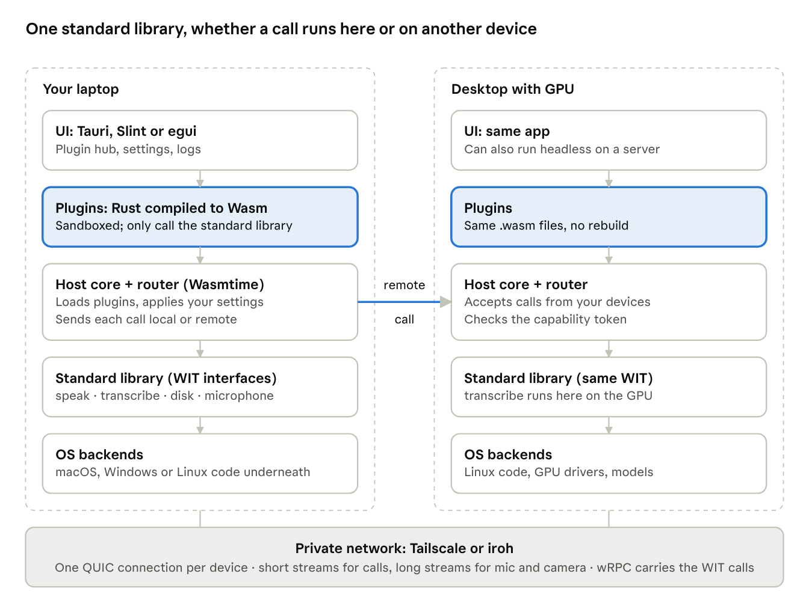

# Bricolo: Plugin Platform Architecture

A cross-platform automation layer on top of the OS, inspired by Hammerspoon, with a Rust core, a Rust UI, and plugins written in Rust and distributed as WebAssembly components.

## At a glance

how it fits together · two devices, one standard library

A plugin calls the standard library; the router decides whether that call runs on this device or goes over the private network to another one with the same API.

## Building blocks (Zed's approach, reused)

Zed's extension system can't be lifted out of the editor and much of its code is GPL, so reuse the same open pieces instead and use Zed's repo as a guide:

| Block | Role |
|----|----|
| Wasmtime | Runs plugins inside the host |
| WIT | Defines the standard library interfaces |
| wit-bindgen, cargo-component | Generate the Rust glue for plugin authors |
| wRPC | Carries the same WIT interfaces over the network |
| quinn or iroh | QUIC transport between devices |
| Tailscale or Headscale | Private network across your devices |

## Goals

- Simple, low-level building-block plugins (speech-to-text, text-to-speech, hotkeys, windows, clipboard, files) that other plugins can compose.

- Anyone can build an app by combining plugins.

- Plugins are written in Rust, built once, and run on macOS, Linux and Windows.

- Install or update a plugin, then restart (or hot-reload). No full app rebuild.

## High-level architecture

1.  **Host core (Rust, native).** Owns process lifecycle, plugin loading, permissions, event bus, and all OS access.

2.  **Platform backends (Rust, per OS).** One implementation per OS for each capability: macOS (Accessibility, AVFoundation, CoreAudio), Windows (Win32, WinRT, SAPI), Linux (X11/Wayland, PipeWire, D-Bus).

3.  **Capability interfaces (WIT).** Stable, OS-neutral contracts such as speech.transcribe, tts.speak, hotkey.register, window.focus. This is the "port" layer: plugins depend on the interface, each OS supplies the implementation.

4.  **Plugins (Rust compiled to WebAssembly components).** Loaded by Wasmtime at runtime, sandboxed, portable.

5.  **UI (Rust).** Hub of plugin cards, on/off switches, settings, logs.

## Why WebAssembly components

- **Portable:** one .wasm file runs on every OS; no per-platform builds for plugin authors.

- **Runtime loading:** drop into the plugins folder, restart or hot-reload.

- **Sandboxed:** a plugin only gets the capabilities the user grants (for example microphone, network, files).

- **Composable:** the Component Model lets plugins import interfaces exported by other plugins, so high-level plugins build on low-level ones.

- **Stable ABI:** avoids Rust's unstable native ABI problem with dynamic libraries.

## Alternatives considered

- **Compile plugins into the app (Tauri-plugin style):** fastest, but every install needs the Rust toolchain, minutes of build time, and breaks macOS code signing. Plugins also get full privileges.

- **Native dynamic libraries (.dylib/.so/.dll):** needs a C ABI or the abi_stable crate; per-OS builds; no sandbox.

- **Embedded scripting (Lua via mlua), like Hammerspoon:** great for quick user scripts. Could be offered as an optional extra layer on top of WASM plugins.

- **Separate processes (sidecars / local HTTP):** what the current Hammerspoon setup does (speech server on 8765, TTS queue on 8790). Good for heavy ML models that should stay warm; can be wrapped behind a capability interface.

## Plugin model

- Each plugin has a manifest: name, version, exported interfaces, imported interfaces, requested permissions.

- Lifecycle hooks: init, on_event, dispose.

- Host provides helpers similar to the existing lib/context.lua: timers, watchers, tasks, tiles, settings, logging.

- Dependency resolution at load time based on imported and exported interfaces.

## Heavy native work

Things WASM can't do directly (GPU inference, real-time audio, OS frameworks like Metal or Core ML) live in the host or in native sidecars, exposed to plugins through capability interfaces. Example: speech.transcribe is implemented by the host calling a warm Whisper or Parakeet model; plugins just call the interface.

## Network layer: a standard library over the network

Every device runs a node that exposes the same standard library, so a call like transcribe or save runs locally or on another machine with no change to the plugin. Target scale is a personal mesh of up to about 10 devices.

- **Private network:** Tailscale on every device (Mac, Windows, Linux, iPhone, Android, servers, GL.iNet routers). Headscale as a self-hosted control server to avoid lock-in.

- **One transport for everything:** QUIC, with one connection per machine and many independent streams inside it. A call is a short stream; a microphone or camera feed is a long one. Streams never block each other, so a file transfer can't stall live audio.

- **Rust crates:** [quinn](https://github.com/quinn-rs/quinn) for QUIC, or [iroh](https://github.com/n0-computer/iroh), which adds direct device-to-device connections by key and NAT traversal and could later replace Tailscale.

- **Interfaces:** the same WIT definitions used by local WebAssembly plugins, carried over the network with [wRPC](https://github.com/bytecodealliance/wrpc) (Bytecode Alliance). Cap'n Proto is an alternative with built-in capability tokens.

- **Security:** each node only accepts calls from devices in the mesh, plus a per-capability token.

### Two kinds of capability

| Kind | Examples | Pattern |
|----|----|----|
| Call | Disk, TTS, speech-to-text, image generation, email | Request and reply on a short stream |
| Stream | Microphone, camera, screen, speakers | Continuous low-latency media on a long-lived stream |

iPhone can act as a camera or microphone node while its app is in the foreground; iOS limits capture in the background.

### Settings and router

- **Settings** are the user's rules: for example transcription prefers the desktop GPU, files go to the NAS, personal data never leaves the phone.

- **Router** applies them on every call: checks which devices are online and offer the capability, then picks the best one, with fallback (desktop asleep, so use the laptop).

- v1: manual settings, one chosen device per capability. Later: automatic routing.

## First capabilities

Four capabilities that together test every hard part of the design, built on Mac, Linux and Windows:

1.  **Disk** (call): proves routing and remote calls work.

2.  **TTS** (call): heavy compute, model selection.

3.  **Speech-to-text** (call): reuses the existing speech servers.

4.  **Microphone** (stream): first live media stream across devices.

## Related projects

- **Plan 9** (Bell Labs): every resource on every machine exposed as a mountable file. Same idea, older stack.

- **Exo:** pools devices to run AI models together.

- **MCP:** a standard way to expose capabilities to agents over a port.

- **Zed:** Rust editor with WebAssembly extensions written in Rust; a reference for the plugin model.

- **Extism:** framework for WebAssembly plugin systems with host functions; could replace hand-rolled Wasmtime plumbing.

## UI options

- **Tauri:** web UI, fastest to build, small binaries.

- **Slint:** declarative native Rust UI, good for a polished hub.

- **Iced:** Elm-style, pure Rust.

- **egui:** immediate mode, ideal for tools and debug panels.

- **GPUI (Zed):** very fast, GPU-rendered, less mature as a library.

## Suggested first milestones

1.  Rust host with Wasmtime loading a hello-world component from a plugins folder.

2.  Define the first WIT interfaces: log, hotkey, tts, speech.

3.  macOS backends for those, reusing the existing speech and TTS servers.

4.  Port one existing Hammerspoon plugin (for example the voice inbox) as a test.

5.  Minimal UI hub with plugin cards and toggles.

6.  Add Linux and Windows backends for the same interfaces.

## Open questions

- Hot-reload versus restart-only for v1?

- Plugin registry or Git-based install?

- Permission prompts: per plugin at install, or per capability at first use?

- Offer Lua scripting as a second tier for quick personal scripts?
