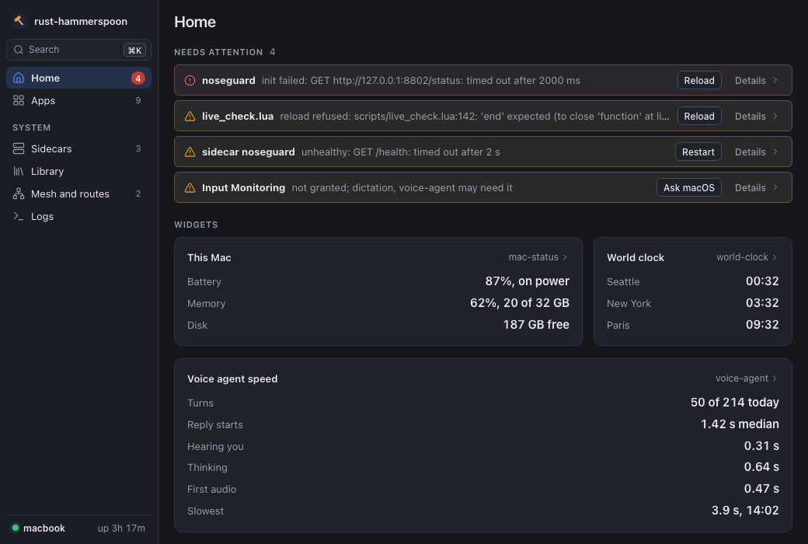
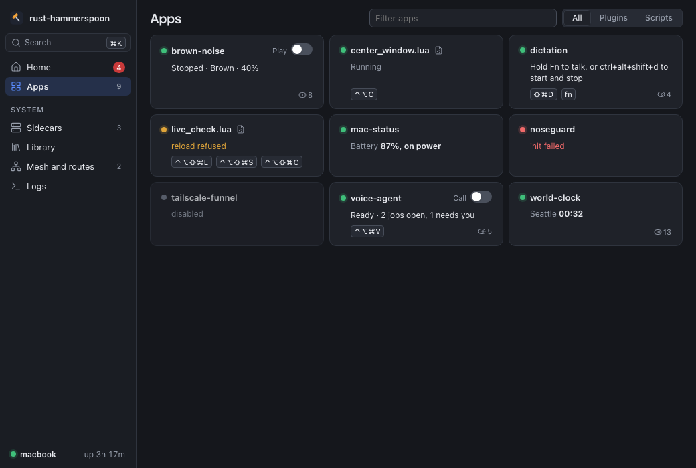
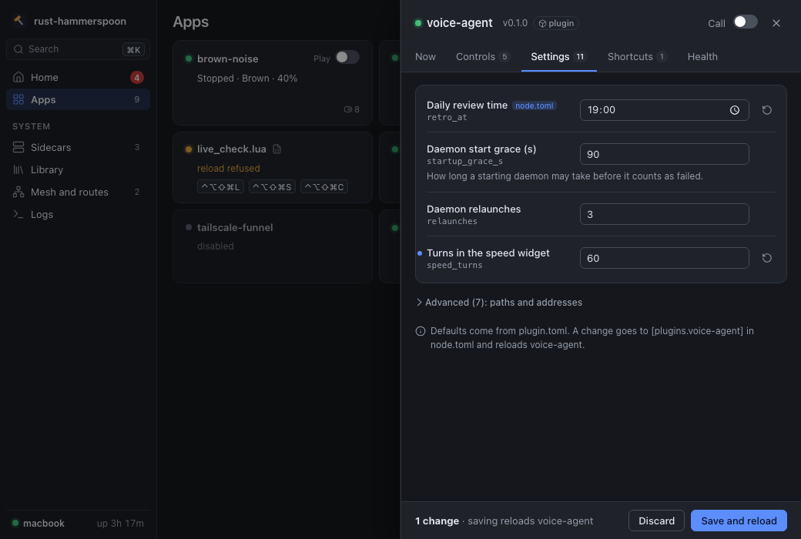
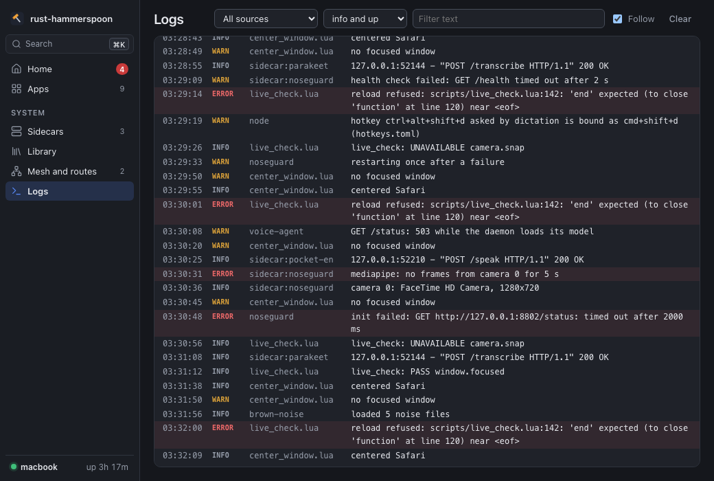
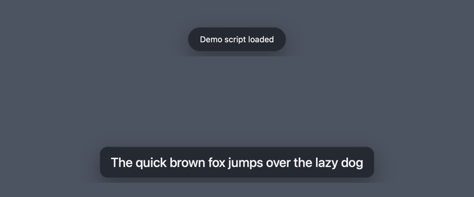
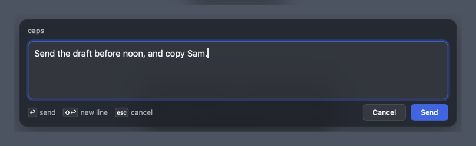

# The hub, the menu bar and panels

`bricolo-ui` is the desktop app for a node: a hub window, a menu bar item and the floating panels that plugins and scripts show. It is a Tauri 2 app in its own process (design Decision 8). It talks to the node over the control socket, so a crash in the UI never stops an automation, and a node runs fine without it.

## Running it

```sh
just ui                              # builds target/release/bricolo-ui and bricolo
target/release/bricolo run                # in one terminal
target/release/bricolo-ui                 # in another, or from Finder
```

`bricolo-ui` alone works too. While no node answers, the hub says "Node not running" and offers Start node, which runs `bricolo run` in the background. It looks for `bricolo` next to `bricolo-ui` first, then in the app bundle's `Contents/Helpers/bricolo.app`, then on `PATH`. Installed with `just install-macos`, the node already runs as a LaunchAgent ([install.md](install.md)). The node it starts keeps running when you quit the UI. Its output goes to `<data>/logs/bricolo-run.log`, next to the node's daily log.

`bricolo-ui --background` starts with the menu bar item only; the hub opens from its menu or with cmd+` ([the chord](#the-chord)). `bricolo-ui --view logs` opens the hub on another view: `home` (the default), `apps`, `sidecars`, `library`, `mesh` or `logs`. The older names `widgets`, `plugins` and `scripts` open Home or Apps. On macOS the hub has no title bar and no close button: Esc, the chord or a click outside it hides it. Quit bricolo-ui from the menu bar item.

The hub opens on the Space you are in, over a full-screen app too. Opening it from the menu bar brings bricolo-ui to the front. Started from a terminal, it may open behind the terminal, because macOS 14 and later let an app take the front only after you act on it.

`bricolo-ui` finds the node through `BRICOLO_DATA_DIR` (default `~/.local/share/bricolo`), the same variable `bricolo` reads. To point both at a test setup:

```sh
export BRICOLO_CONFIG_DIR=/tmp/bricolo-test/config BRICOLO_DATA_DIR=/tmp/bricolo-test/data
bricolo run & bricolo-ui
```

When the node stops or restarts, the hub shows it as down and reconnects on its own, retrying after 250 ms and backing off to every 2 seconds.

## The chord

On macOS, cmd+` toggles the hub, the way Hammerspoon toggles its console. A hidden hub drops down from the top centre of the screen that holds the pointer, flush under the menu bar, so on a MacBook with a notch it hangs from the notch. It is three quarters of the screen wide and half of it tall, not counting the menu bar and the Dock, and the mouse can neither move nor resize it. Set `SIZE` in `crates/ui/src/dropdown.rs` to `(1.0, 0.5)` for the full width. It opens on the Space you are in, over a full-screen app too, and takes the keyboard, so you can type in the log filter at once. cmd+` again, or Esc while the hub has the keyboard, hides it and gives the front back to the app you were in. Esc hides the hub however it opened. A click outside the hub, in another app or on the desktop, hides it too, and the app you clicked keeps the front. A choice list or review panel taking the keyboard leaves the hub open.

Open hub in the menu bar, and starting bricolo-ui without `--background`, drop the hub down the same way. On Linux the hub stays a normal window.

`BRICOLO_UI_CHORD` picks another chord in the syntax of the `global-hotkey` crate, like `cmd+alt+h`, and `BRICOLO_UI_CHORD=off` turns the chord off. bricolo-ui reads it at start. When another app holds the chord, bricolo-ui prints a warning and runs without it. macOS binds cmd+` to Move focus to next window (System Settings > Keyboard > Keyboard Shortcuts > Keyboard). If cmd+` still cycles windows while bricolo-ui runs, turn that shortcut off.

The chord works only while bricolo-ui runs. `bricolo service install --app --ui` adds a login agent that starts `bricolo-ui --background` with the node ([install.md](install.md)), so the chord is there after each login.

## The hub

The sidebar has Search, then Home and Apps, then a System group: Sidecars, Library, Mesh and routes, and Logs. cmd+1 to cmd+6 open those six views in that order. Search, cmd+K, or / while no text box has the keyboard, opens the [palette](#the-palette). The foot of the sidebar shows the node's name and uptime; hover it for the pid.

- **Home** opens first. On a Mac, **Set up this Mac** comes first until every grant is answered or you press Done for now: one step per macOS grant (Accessibility, Post key and mouse events, Input Monitoring, Microphone, Camera, Screen Recording), what it is for, the capabilities that use it from the catalog (Accessibility for `accessibility`, `window` and `selection`; Screen Recording for `screen` and `accessibility` screenshots), and Ask macOS and Open Settings buttons. The Library's "Show the setup walkthrough on Home" brings it back. Needs attention lists what is wrong, each with its fix: a plugin or script that is off or refused (Reload), one running with an error, a sidecar that is restarting or unhealthy (Restart), and a macOS grant the node lacks that a running plugin's capabilities need (Ask macOS). macOS tells a process about posting events, Input Monitoring and Screen Recording only once, when it first asks, so a grant you turn on while the node runs stays unseen until the node starts again. The node checks with a new run of its own program (`bricolo permissions --local`, at most every 5 seconds while one of those three is missing), and Home then shows the grant as granted with a Restart node button, in the walkthrough and under Needs attention. Restart node sends `restart-node`: the node stops and runs its program again in the same process, so launchd or systemd keep watching it, and the hub reconnects. Home asks for the grants at most every 10 seconds. Below that are the switches you pinned, then every widget. The number next to Home counts what needs attention.
- **Apps** has one card per plugin and per script, sorted by name, with a filter box and All, Plugins and Scripts. A card shows the state as a dot, the name, one line (the app's status text, else its error, else its widget's first row) and its shortcuts. When the app's controls have exactly one switch, like voice-agent's Call, it sits on the card. A click on the card, or ↩, opens the app's drawer.
- **Sidecars** lists the sidecars from `node.toml` with state, port, pid, restarts, the last error and a Restart button.
- **Library** shows the standard library and what you let bricolo touch on this Mac ([below](#the-library)).
- **Mesh** shows this node's endpoint id and each peer in `peers.toml` with its connection state. Under the routes, **AI agents** says whether the [MCP gateway](mcp.md) runs and where it listens, with buttons that add it to Claude Code or Claude Desktop.
- **Logs** follows the log lines of the node, the plugins, the scripts and the sidecars. Filter by source, by lowest level, or by text. Follow keeps the newest line in view.







A red "Recording" badge at the top, and a dot in the menu bar, show while a plugin or script uses the microphone, the camera or the screen (Decision 5).

### An app's drawer

The drawer slides in from the right and takes the keyboard on its current tab; ← and → move between tabs. Esc, ✕ or a click beside it closes it and gives the keyboard back to the app's card. In the Apps view the arrow keys move between cards and ↩ opens one. Its header holds the app's main switch, when it has one. Its tabs split what an app shows by what you do with it:

| Tab | What it holds | You |
|---|---|---|
| Now | the status text and the widget, and Show this widget on Home | read |
| Controls | the switches and buttons the app set with `set-tile`; Pin puts a switch on Home | act now |
| Settings | the plugin's `[settings]`, drawn as a form ([below](#settings)) | change how it behaves |
| Shortcuts | the hotkey chips ([below](#changing-a-shortcut)), and Run to deliver a plugin's hotkey now | change or run a chord |
| Health | the state, restarts, timers, the error, its last log lines, All its logs, Reload and Turn off | fix it |

The hub keeps pins and the widgets you took off Home in the webview's local storage, not on the node.

Turning a plugin or script off in the hub stops it and keeps it off across node restarts. The node records the choice in `<data>/state.toml`:

```toml
# Written by bricolo: what the hub turned off.
disabled_plugins = ["window-tiler"]
disabled_scripts = []
```

A turned-off plugin or script shows the state `disabled`. Saving its files does not start it. Turn on in its Health tab, the menu bar item or `{"cmd":"enable",...}` turns it on again.

### Settings

A plugin's Settings tab is drawn from `[settings]` in its `plugin.toml`, so every plugin has one without code. The default picks the field: true or false is a switch, a number a number box, a string like `"18:30"` a time, a list of strings a comma-separated box, other strings a text box. Strings that start with `/`, `~` or `http` (paths and addresses) go under Advanced. Tables and dates show but cannot change in the hub.

`[settings_ui.<key>]` refines one setting. Each must name a key of `[settings]`, and `choices` need a string or a list of strings as the default:

```toml
[settings]
voice = "alba"
retro_at = "18:30"
chord = "ctrl+alt+cmd+v"

[settings_ui.voice]
label = "Voice"
help = "Used from the next call."
choices = ["alba", "marius"]     # a string picks one; a list picks several

[settings_ui.chord]
hidden = true                    # the Shortcuts tab holds it
```

`advanced = true` or `false` overrides where a setting goes. A changed field shows a dot and ↺, which puts back the default; a value set in node.toml shows `node.toml`. Save and reload writes `[plugins.<name>]` in `node.toml` and reloads the plugin, which reads the new values in `init`. Only the values that differ from the defaults are written, and the section goes away when none do. The edit goes through `toml_edit`, so comments and the rest of the file stay as they were, and the whole file is checked before it replaces the old one. A wrong type, an unknown key or a value outside `choices` is refused and the file stays as it was. Scripts have no settings tab yet.

Put an option the user may change in `[settings]`, not in a switch or a button: controls are for acting now.

### The palette

The palette searches every switch (Turn on, Turn off), every button (Run), every plugin hotkey (Run, shown with its chord, which delivers it as `bricolo fire` does), each app (Open, Settings) and each view (Go to, with its cmd+1 to cmd+6 key). Type words in any order; ↑ ↓ or the pointer pick, ↩ runs, Esc closes. With the chord, cmd+` then cmd+K, "call" and ↩ starts a voice-agent call.

### Changing a shortcut

Every hotkey a plugin or script binds shows as a chip in its drawer's Shortcuts tab, and every chip works the same way: click it, then press the new shortcut. Esc, or a click elsewhere, cancels. A shortcut needs cmd, ctrl or alt, unless it is an F key. A chip you changed gets a ↺ button that puts back the shortcut the app asks for. When the node refuses a shortcut, because another plugin or another app holds it, the reason shows under the chips and the old shortcut stays bound.

The plugin or script is not told and needs no code for it: it keeps asking for its own chord, and the node binds yours instead. The node matches your change by the chord the app asks for, so it holds across restarts, reloads and edits that keep that chord. It records the changes in `<data>/hotkeys.toml`:

```toml
# Written by bricolo: chords changed in the hub. For each plugin or script,
# the chord it asks for = the chord bound instead.
["dictation.lua"]
"ctrl+alt+d" = "cmd+shift+d"
```

A shortcut another binding holds never reaches the hub, because the OS hands it to its owner first: press it and nothing happens. The Fn key works only as the chord an app asks for, since the hub cannot see it.



## The Library

The Library view has two parts. `bricolo-ui --view library` opens the hub on it.

**macOS access** lists the 6 grants the node can hold: Accessibility, Post key and mouse events, Input Monitoring, Microphone, Camera and Screen Recording. Each row shows granted, missing, not asked, or needs a restart, with Restart node, for a grant macOS holds that the node sees only from its next start (see Home). Only Microphone and Camera can tell "not asked" from "missing". The title names the program macOS gives the grants to. For the installed app that is "bricolo node" (the helper app, see [design.md](design.md)). A node started from a terminal says "your terminal (ghostty)", because macOS checks the terminal app then, and the view warns that turning a grant off there takes it from everything run in that terminal. Microphone, Camera and Screen Recording show "in use now" while a plugin or script uses them.

- **Ask**, on a grant that is missing or not asked, asks macOS for that one grant and opens its pane in System Settings. macOS shows each prompt only once per program, so after a refusal the pane is the only way.
- **Revoke…**, on a held grant, opens the same pane. macOS lets no program remove its own grant, so you turn the entry off there. The view checks again when the hub gets focus back.

**Capabilities** has one card per interface in `wit/`: its name, the first sentence of its doc comment, the grant it needs on macOS, and what may call it. A ⚠ marks a capability whose grant is missing; its calls answer `denied` until you grant it. Each plugin approved for the capability in `permissions.toml` is a link to its drawer's Health tab, where Turn off stops it. Scripts get every capability, so the card counts them as "all scripts". The list is read only: removing one capability from a plugin would only make the node refuse the whole plugin, which Turn off already does. The filter box searches names and descriptions.

The descriptions come from `wit/` at compile time (`crates/providers/src/catalog.rs`), and the grant each capability needs is written there by hand. A test fails when the catalog and `wit/world.wit` disagree.

## The menu bar item

The menu has Open hub, the node's state (with Start node while it is down), a checkbox per plugin, a Scripts submenu with a checkbox per script, and Quit. While something records, the menu shows "● Recording: <plugin> (<sensor>)" and the item shows a dot next to its icon.

## Panels

Plugins and scripts show four kinds of floating panel:

| Kind | Where | What the user can do |
|---|---|---|
| caption | bottom center of the main screen | nothing; clicks go through to the app below |
| toast | just above the caption's and the review's place; hides after 4 s unless the panel sets `timeout-ms` | nothing; clicks go through |
| choice list | upper third of the main screen | pick with ↑ ↓ and ↩, a digit 1 to 9, or the mouse; esc dismisses |
| review | a bar at the bottom center of the main screen, in the caption's place | read and edit the text; ↩ or Send sends it (accepts), ⇧↩ adds a line, esc cancels |

The main screen is the one you work on. On macOS that is the screen with the focused window, whichever app owns it, or the screen with the pointer when no window has focus. On Linux it is the screen with the pointer. Each panel moves there every time it shows.





Panels never take focus from the app in front. On macOS each panel window is a non-activating `NSPanel` (through `tauri-nspanel`) at the status window level, on every Space and over full-screen apps. A choice list or review panel becomes the key window so it gets the keyboard, but the app in front stays active, the way Spotlight works. On Linux and Windows the panels are undecorated, always-on-top windows created without focus; a choice list or review panel asks for focus when it shows.

Each owner has one panel of each kind. Showing a kind again replaces that panel's content and keeps its id, so a live caption can update many times a second. When several owners show the same kind, the newest one is on screen.

## The `ui` capability

Plugins and scripts describe their controls, their widget and their panels as data; they never ship HTML or JavaScript. `wit/ui.wit` defines the calls. They are local and quick, so they are sync, and `ui` never runs on a peer.

```wit
set-tile: func(tile: tile) -> result<_, call-error>;
clear-tile: func() -> result<_, call-error>;
set-widget: func(widget: widget) -> result<_, call-error>;
clear-widget: func() -> result<_, call-error>;
show-panel: func(panel: panel) -> result<string, call-error>;
hide-panel: func(id: string) -> result<_, call-error>;
```

A plugin lists `"ui"` in `imports` and you approve it at install, like any capability. What the user does arrives as a `ui` event:

```rust
use bricolo::stdlib::types::UiEvent;
use bricolo::stdlib::ui;

ui::set_tile(&ui::Tile {
    title: "Inbox".into(),
    status_text: "3 new".into(),
    switches: vec![ui::Switch { id: "auto".into(), label: "File automatically".into(), on: true }],
    buttons: vec![ui::Button { id: "now".into(), label: "File now".into() }],
})?;

// Only for a value worth a glance in the Widgets view:
ui::set_widget(&ui::Widget {
    title: "Inbox".into(),
    rows: vec![ui::WidgetRow { label: "Unread".into(), value: "3".into() }],
})?;

// in on_event:
match event {
    Event::Ui(UiEvent::Switch(s)) => log::write(Level::Info, &format!("{} is now {}", s.id, s.on)),
    Event::Ui(UiEvent::Button(id)) => { /* ... */ }
    Event::Ui(UiEvent::Choice(c)) => { /* c.index is None when dismissed */ }
    Event::Ui(UiEvent::Review(r)) => { /* r.accepted, r.text */ }
    _ => {}
}
```

Scripts use `bricolo.ui` with callbacks instead of events; see [scripts.md](scripts.md#the-bricolo-library).

The tile holds the controls; the hub draws its status text on the owner's card and in the Now tab, and its switches and buttons in the Controls tab. The widget is a separate call, for values worth seeing at a glance, on Home and in the Now tab; a plugin whose tile shows its state needs no widget. Options the user sets once belong in `[settings]` ([above](#settings)).

Limits: titles, labels, widget values and choices up to 200 bytes, panel text up to 64 KiB, 16 switches and 16 buttons per tile with unique ids, 16 rows per widget, and 50 choices per list. A call over a limit answers `failed`. When a plugin or script stops, the node removes its tile, widget and panels.

The node keeps tiles, widgets and panels even while no hub is connected; a hub that connects later draws them.

## The control socket

`bricolo-ui` uses the same socket as `bricolo status`: `<data>/bricolo.sock`, one JSON object per line. These requests were added for it:

| Request | Answer |
|---|---|
| `{"cmd":"subscribe"}` | turns the connection into a stream of events (below) |
| `{"cmd":"enable","plugin":"<name>"}`, `{"cmd":"disable","script":"<name>"}` | `{"enabled": bool, "status": {...}}`; records the choice in `state.toml` |
| `{"cmd":"restart-sidecar","sidecar":"<name>"}` | `{"restarting": "<name>"}`; stops the process and starts it at once, skipping any backoff |
| `{"cmd":"set-hotkey","plugin":"<name>","id":"<id>","chord":"cmd+shift+d"}`, or `"script"` | `{"hotkey": id, "owner": .., "chord": ..}`; binds the chord in place of the one the app asked for and records it in `hotkeys.toml`. `"chord": null` puts back the app's own |
| `{"cmd":"ui-action","action":{"kind":"switch","owner":"<owner>","id":"<id>","on":true}}` | `{"ok": true}`; also `button` (`owner`, `id`), `choice` (`panel`, `index` or `null`) and `review` (`panel`, `accepted`, `text`) |
| `{"cmd":"sensor","plugin":"<plugin>","sensor":"mic","active":true}` | marks a sensor in use by hand, to test the recording dot; `sensor` is `mic`, `camera` or `screen` |
| `{"cmd":"library"}` | `{"os", "holder", "grants": [{name, label, state}], "capabilities": [{name, summary, needs, note, plugins}], "scripts": [...]}`; `state` is `granted`, `missing`, `not-asked`, `restart` (macOS holds it, but the node sees it only after `restart-node`) or `n/a` off macOS |
| `{"cmd":"permissions","request":true,"grant":"camera"}` | asks macOS for one grant, then answers like `permissions`. Without `grant`, `request` asks for Accessibility and Input Monitoring, as `bricolo permissions --request` does |
| `{"cmd":"settings","plugin":"<name>"}` | `{"plugin", "settings": [{key, label, help, kind, choices, advanced, hidden, default, value, overridden}]}` in plugin.toml order; `kind` is `bool`, `integer`, `float`, `time`, `text`, `choice`, `multi`, `list` or `other` |
| `{"cmd":"set-settings","plugin":"<name>","values":{"voice":"marius"}}` | writes `[plugins.<name>]` in `node.toml`, reloads the plugin, then answers like `settings` plus `status`; a `null` value or the default removes the override |
| `{"cmd":"open-settings","grant":"camera"}` | `{"opened": "<url>", "grant": ..}`; opens the grant's pane under Privacy & Security. An error off macOS |
| `{"cmd":"restart-node"}` | `{"restarting": true}`; then the node stops everything and runs `bricolo run` again in the same process (same pid), so macOS answers the grants afresh. An error on Windows |
| `{"cmd":"mcp-connect","client":"claude-code"}` | `{"connected": true, "message": ".."}`; adds the MCP gateway to Claude Code (`claude mcp add`) or, with `"claude-desktop"`, to Claude Desktop's config |

A subscription sends:

- `{"event":"status","status":{...}}` at once and whenever the status changes, `uptime_s` aside. The node checks after each request that changes something, when a sensor turns on or off, and every second.
- `{"event":"ui","ui":{"tiles":{...},"widgets":{...},"panels":[...]}}` at once and after each change to a tile, widget or panel.
- `{"event":"logs","lines":[...]}` once, with the last 500 lines, then `{"event":"log","line":{"ts_ms":..,"plugin":..,"level":..,"message":..}}` for each new one. A line about one plugin, script or sidecar (`sidecar:<name>`) carries its name; the node's other lines say `node`.
- `{"event":"lagged","skipped":n}` when the reader fell behind and lost `n` log lines.

Each plugin and script in `status` has `hotkeys` (id to the chord bound now) and, for the ones changed in the hub, `hotkey_defaults` (id to the chord the app asked for). A script's ids are `h1`, `h2` and on, in the order of its `bind` calls. `status` also has `mcp`: `{"enabled", "http"}`, the gateway and its HTTP address. `status` now also has `active_sensors`, a list of `{plugin, sensor}`. The `mic` capability sets one while it records; scripts show as `<name>.lua`.

A node from before `subscribe` answers it with an error. `bricolo-ui` then asks for `status` every 2 seconds on the same connection instead.

The hub sends only `status`, `reload`, `reload-script`, `enable`, `disable`, `restart-sidecar`, `ui-action`, `fire`, `set-hotkey`, `library`, `permissions`, `open-settings`, `restart-node`, `settings`, `set-settings` and `mcp-connect`. `bricolo-ui` refuses anything else that comes from its web pages, so a bug in a page cannot reach `call`.

## Smoke test

`scripts/ui-smoke.sh` builds `bricolo`, `bricolo-ui` and the test plugins, runs a node and the hub against a temporary config, and takes screenshots. It checks that a caption and a review panel leave the app in front unchanged, and that the review answer reaches the plugin. `--save` copies the screenshots to `docs/screenshots/`. For the panels' screenshot it puts a plain grey window behind them, so the picture shows nothing else that is on screen. It needs an unlocked screen and the Screen Recording permission for the terminal.

## Inside bricolo-ui

- `crates/ui/src/client.rs` follows the node: one subscription, reconnecting with backoff, and one-shot requests. `launch.rs` finds `bricolo` and starts it detached. Both are plain Rust with unit tests.
- `main.rs` holds the Tauri app and what the node last reported. `tray.rs` builds the menu bar item, `panels.rs` the panel windows. `toggle.rs` registers the chord through `global-hotkey` and drops the hub down, hides it and puts it back with AppKit calls. `dropdown.rs` holds the pure part, with unit tests: the screen under the pointer and the hub's frame on it.
- `crates/ui/ui/` is the front end: static HTML, CSS and ES modules, with no build step and no network. `js/store.js` holds what the hub knows (the node's last report, the open view and drawer, pins), `js/home.js` draws Home, `js/apps.js` the Apps view and the drawer with its Settings form, `js/palette.js` the palette, and `js/library.js` the Library view, keeping its filter box across status ticks. A re-render gives the keyboard back to the element marked `data-focus` (a filter, a setting, a card, the drawer's current tab), so typing or moving with the arrows survives a status tick. `css/theme.css` holds the colours and the design tokens (spacing, radii, type sizes, motion, elevation) both pages use, and `js/icons.js` a small inline icon set from Lucide (ISC). `crates/ui/dev/` runs the same front end in a browser against a fake node, for design work: `just hub-dev`. `just hub-shots` renders the four `hub-*.png` screenshots from it with headless Chrome. A view's top toolbar, marked `data-header`, is moved into the header beside the title. `js/chord.js` holds the hotkey chip every Shortcuts tab uses, so changing a shortcut looks and works the same for every plugin and script. `withGlobalTauri` gives the pages `window.__TAURI__`. The pages follow the system's light or dark appearance; panels always use a dark style.
- `tauri.conf.json` carries the bundle identifier `com.pierre-mike.bricolo` and the icons in `crates/ui/icons/`. `crates/ui/Info.plist` adds `LSUIElement` and the usage strings. `just bundle-macos` builds the signed app with the node inside, and Start node finds `bricolo` in its helper app ([install.md](install.md)).

On Linux, building `bricolo-ui` needs WebKitGTK 4.1, GTK 3 and libayatana-appindicator, as the CI's Ubuntu job installs them. `just check-linux` skips `bricolo-ui` because a cross-check from macOS has no GTK. On Windows `bricolo-ui` reaches the node through its named pipe and starts `bricolo run` with a hidden console, but it is not built or checked there yet: `just check-windows` and the Windows CI job skip it, because its WebView2 build is not set up ([windows.md](windows.md#the-hub)).
